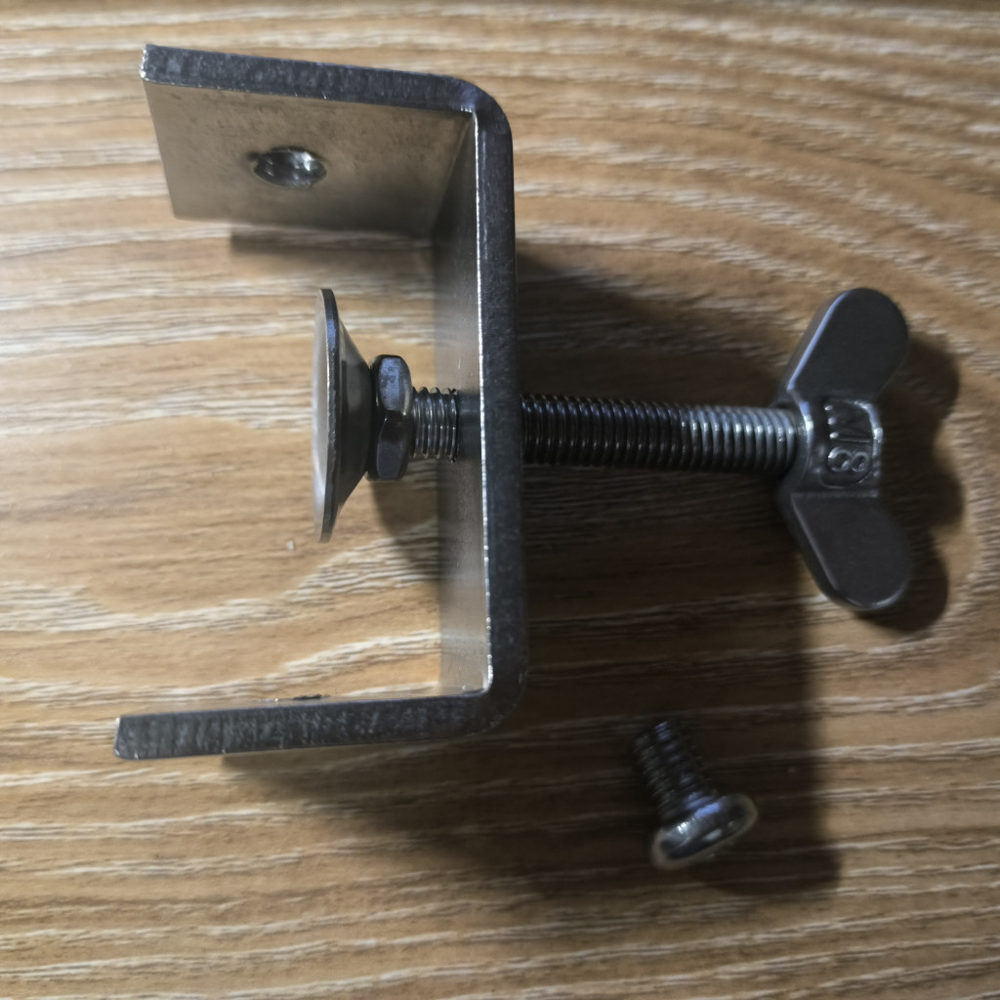

# 自动按键器

本项目是一个简易的自动按键器，旨在通过定期触发推拉式电磁铁去按压实物按钮。

## 目录说明：

- pcb/ : PCB 工程文件。
- 3dp/ : 外壳设计工程文件以及导出的 3mf 文件（3D 加工文件）。
    - auto_click.FCStd: 原始工程文件。
    - auto_click-Main-6.3mf: 支架主体部分的 3D 加工文件。
    - auto_click-PCBShell-6.3mf: PCB 盒部分的 3D 加工文件。
- img/ : 本文档使用到的图像。

## 工具链

- PCB EDA：嘉立创 EDA 专业版 v4.1.78
- 外壳 CAD：FreeCAD 1.1.4

## 调节方法

改变 R1 R2 C8 的值，即可修改定时长度的理论值。一个完整周期是由充电阶段（此时电磁铁未通电，处于复位状态，持续时间为 $t_1$）与放电阶段（此时电磁铁通电伸出，持续时间 $t_2$）计算公式：

$$
\begin{array}{ll}
    t_1 & = (R_1 + R_2) C_8 \ln 2 \\
    t_2 & = R_2 C_8 ln_2
\end{array}
$$

其中，上电之后首个周期的充电阶段时间可能与稳定工作时不同。取决于 C8 初始电压。假设初始电压为 0，首个周期充电阶段长度为：

$$
t_1'= (R_1 + R_2) C_8 \ln3
$$

以本工程中选用的数值为例：

$$
\begin{array}{ll}
    t_1 & = (100 \mathrm{k\Omega} + 1.54 \mathrm{k\Omega}) \times 470 \mathrm{\mu F} \times \ln 2 \approx 33.08 \mathrm{s} \\
    t_2 & = 1.54 \mathrm{k\Omega} \times 470 \mathrm{\mu F} \times \ln 2 \approx 501.7 \mathrm{ms} \\
    t_1' & = (100 \mathrm{k\Omega} + 1.54 \mathrm{k\Omega}) \times 470 \mathrm{\mu F} \times \ln 3 \approx 52.43 \mathrm{s}
\end{array}
$$

## 配套元件选型

- 夹具：通用 U 型夹，开口 55 mm，厚度 4 mm，夹持面板宽 30 mm，包边长度 35 mm。底孔与侧孔均为 M8。（实物参见附图）
- 推拉式电磁铁：0826B（额度电压 12 V，额定电流 1 A，行程 10 mm，标称推力 20 N）
- 直流电源适配器：额定电压为 12 V，额定电流需大于等于 2 A，接口内正外负。

## 注意事项

- PCB 相关
    - 电容 C1 C2 C3 仅需焊接 C1 C2 即可，多余位置原本在设计时作测试点用。
    - 若不需要指示灯，LED 与相关电阻（R3~R5，R8~R10）均可留空不焊。
    - LED 指示灯您可自行选择需要的阻值。使用本项目型号的 LED 实测发现仅焊两颗并联电阻（例如 R3 R4 与 R8 R9）即有较高亮度，人眼难以直视。总阻值不建议小于 750 Ohm。
- 外壳支架相关
    - 您可以根据您的实际使用场景自行调整外壳支架设计。
    - 仅靠“俺寻思之力”设计，未进行相关受力仿真测试，不保证完全避免支架断裂等情况。期待有机械相关方向的大佬对我的设计优化改进。
    - 打印底面：Main 为 xOz 平面，PCBShell 为 xOy 平面。
    - 在拓竹 H2S 机器上打印测试通过，支架工作良好。参考的打印条件：
        - 耗材：PLA
        - 预设：Generic PLA 0.2 mm
        - 稀疏填充：15% 螺旋体填充
        - 支撑：开启（默认）

## 授权协议与免责声明

- PCB 工程（pcb/ 中的所有文件），以及外壳与支架设计（3dp/ 中的所有文件）以 CERN-OHL-P-2.0 协议授权。
- 本文档及其使用的图片以 CC-BY-4.0 协议授权。
- 本项目为独立开源项目，与本文提到的嘉立创、拓竹及其关联公司无隶属、赞助、认可或合作关系。文中提及相关名称仅用于识别其所指的公司、产品或服务；相关名称及标识的权利归各自权利人所有。
- 本项目的设计文件及基于其制造的产品均按“现状”提供，不保证其安全性、正确性、适用于特定用途，或符合使用者所在地的法规与标准。使用者应根据自身用途独立评估设计，并在制造、组装、改装、安装和使用前进行必要的审查与测试，采取适当的防护措施。硬件的使用可能带来人身伤害、财产损失或其他风险；使用者须自行判断是否适用并承担相应风险。在适用法律允许的最大范围内，贡献者不对因使用、无法使用或基于本项目制造的产品所引起的损害承担责任；法律不允许排除或限制的责任不在此限。

## 其他声明

本项目（包括本文档）所有部分除以下标注的部分以外，均为作者本人亲自设计或写作。

- “授权协议与免责声明”一节由 LLM 辅助生成。
